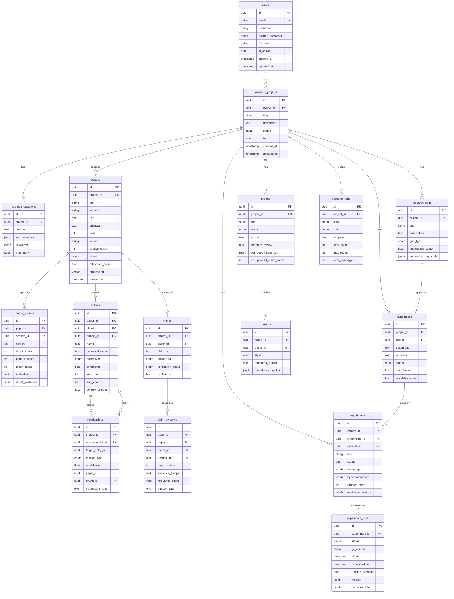

# Database Architecture

## Database Schema



## pgvector Usage

The `paper_chunks.embedding` column stores `vector(384)` (BGE-small dimension).

Key queries:
```sql
-- Cosine similarity search
SELECT id, content, embedding <=> $1 AS distance
FROM paper_chunks
JOIN papers ON paper_chunks.paper_id = papers.id
WHERE papers.project_id = $2
ORDER BY distance
LIMIT 20;

-- HNSW index for production performance
CREATE INDEX ON paper_chunks USING hnsw (embedding vector_cosine_ops)
WITH (m = 16, ef_construction = 64);
```

## Indexes

```sql
-- Full-text search via pg_trgm
CREATE INDEX ON papers USING gin (title gin_trgm_ops);
CREATE INDEX ON paper_chunks USING gin (content gin_trgm_ops);

-- Lookup indexes
CREATE INDEX ON papers (project_id, status);
CREATE INDEX ON paper_chunks (paper_id, chunk_index);
CREATE INDEX ON entities (project_id, entity_type);
CREATE INDEX ON claims (project_id, verification_status);
CREATE INDEX ON research_jobs (project_id, status);
```
