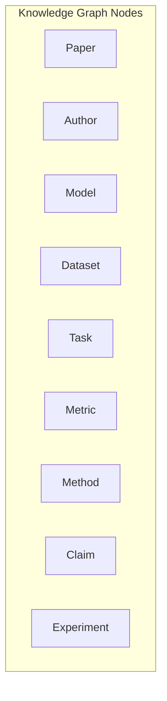
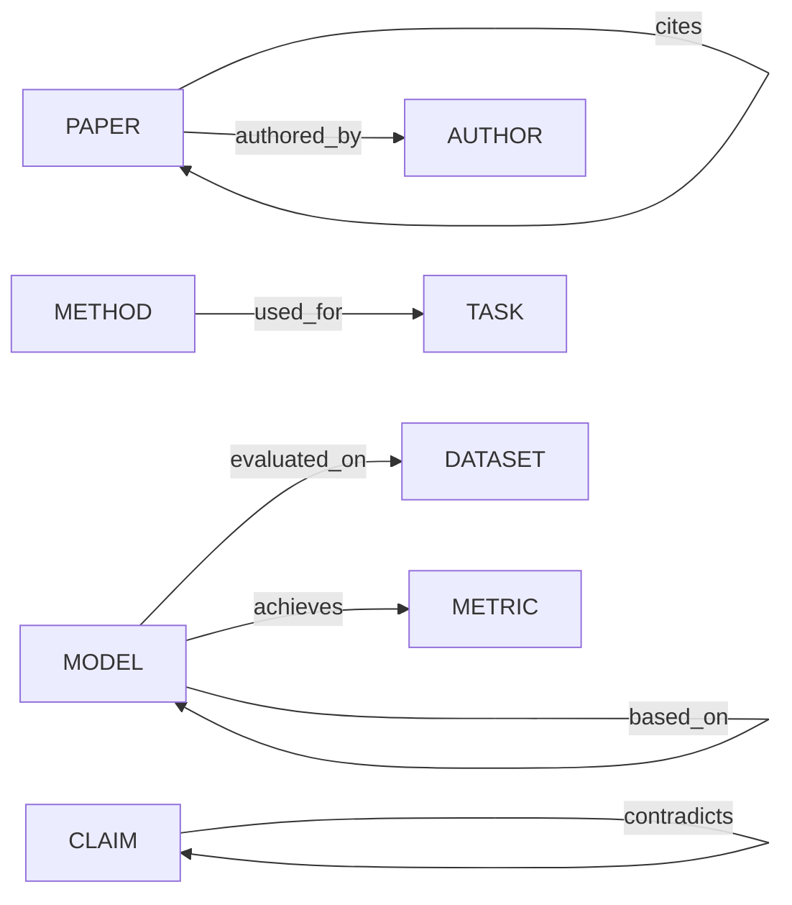

# Knowledge Graph Architecture

## Graph Representation

ResearchMind uses PostgreSQL (with `entities` + `relationships` tables) as a graph store. V1 does not require Neo4j — profiling must demonstrate a real need before adding specialized infrastructure (spec §14).

## Node Types

## Edge Types

## Entity Types (spec §3)

| Type | Examples |
|---|---|
| MODEL | BERT, GPT-4, LLaMA-2, RoBERTa |
| DATASET | SQuAD, GLUE, ImageNet, WMT-2023 |
| TASK | Machine Translation, NER, QA |
| METRIC | F1, BLEU, Accuracy, ROUGE |
| METHOD | Fine-tuning, RLHF, LoRA, RAG |
| BENCHMARK | HELM, BIG-Bench, OpenLLM |
| ORGANIZATION | OpenAI, DeepMind, Stanford |

## Provenance Requirement

Every edge **must** include:
- `paper_id` — source paper
- `chunk_id` — source chunk
- `evidence_snippet` — exact text supporting the relation
- `confidence` — extraction confidence score

This prevents fabricated graph edges and ensures the graph is grounded in actual text.
