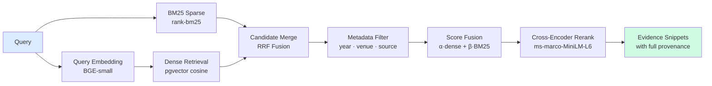
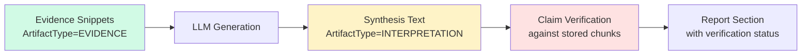

# RAG Pipeline Architecture

## Hybrid Retrieval Pipeline



## Evidence Snippet Structure

Every retrieved snippet exposes:

| Field | Description |
|---|---|
| `chunk_id` | Unique chunk identifier |
| `paper_id` | Source paper |
| `paper_title` | Paper title |
| `authors` | Author list |
| `year` | Publication year |
| `doi` | DOI for citation |
| `content` | Exact text excerpt |
| `page_number` | Page in original PDF |
| `section_title` | Section header |
| `dense_score` | Cosine similarity (0–1) |
| `bm25_score` | Normalized BM25 score (0–1) |
| `final_score` | Post-RRF + rerank score |

## Score Fusion: Reciprocal Rank Fusion

```
RRF(chunk) = α × (1 / (k + dense_rank + 1))
           + β × (1 / (k + bm25_rank + 1))

where k = 60 (standard RRF constant)
      α = dense_weight (default 0.5)
      β = bm25_weight  (default 0.5)
```

## Synthesis Safety Invariant



LLM output is **always** tagged `INTERPRETATION` — it **never** silently becomes `EVIDENCE`.
`EVIDENCE` can only be set when a claim maps to a stored chunk with high verification confidence.
