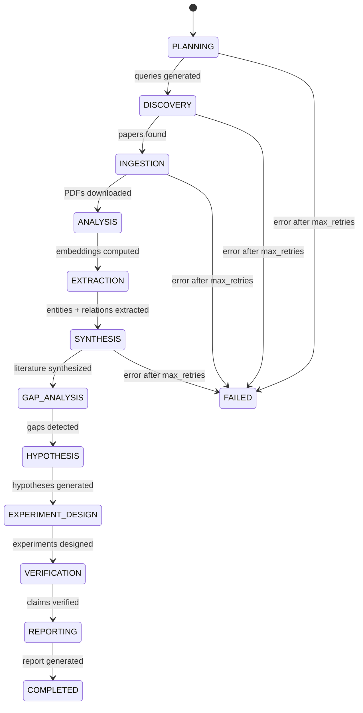
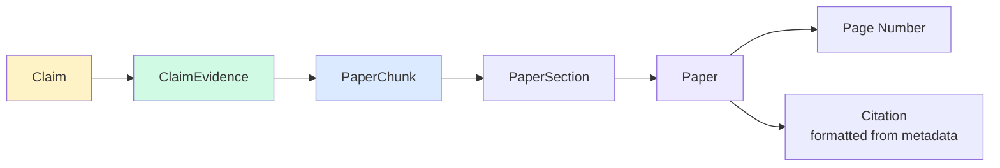

# Research Pipeline

## Full Pipeline Flow

```mermaid
flowchart TD
    RQ[User Research Question] --> WS[Research Workspace]
    WS --> RP[Research Planner\nLLM generates search queries]
    RP --> ALD[Academic Literature Discovery\nSemantic Scholar · OpenAlex · arXiv]
    ALD --> PND[Paper Normalization + Deduplication\nby DOI / arXiv ID]
    PND --> ING[PDF/API Ingestion\nDownload with SSRF protection]
    ING --> DP[Document Processing\nPyMuPDF → section extraction]
    DP --> ENL[Embedding + NLP Extraction\nChunking · BGE embeddings · NER · Relations]
    ENL --> HR[Hybrid Retrieval\nBM25 + pgvector + RRF + rerank]
    HR --> EL[Evidence Layer\nChunk → Paper → Page → Section → Citation]
    EL --> KG[Knowledge Graph\nEntities + Relations stored in PostgreSQL]
    KG --> LS[Literature Synthesis\nLLM grounded in evidence only]
    LS --> RGD[Research Gap Detection\nGaps traced to evidence]
    RGD --> HG[Hypothesis Generation\nFalsifiable · testability scored]
    HG --> ED[Experiment Design\nFull spec: model · baseline · metrics · ablations]
    ED --> ET[Experiment Tracking\nRun ID · git commit · hardware · metrics]
    ET --> CV[Claim Verification\nSUPPORTED · PARTIALLY · CONTRADICTED · INSUFFICIENT]
    CV --> CE[Citation Engine\nFormatted from stored metadata · APA · IEEE · BibTeX]
    CE --> RR[Research Report\nAll 15 sections · verified claims · real citations]
```

## Workflow Stage Machine

## Evidence Traceability Chain

## Retry Policy

Each stage allows up to `JOB_MAX_RETRIES` (default: 3) attempts with exponential backoff:
- Attempt 1: immediate
- Attempt 2: 2s delay
- Attempt 3: 4s delay
- Attempt 4: 8s delay → FAILED (no infinite loops)

Stage timeout: `JOB_TIMEOUT_SECONDS` (default: 3600s per stage).
